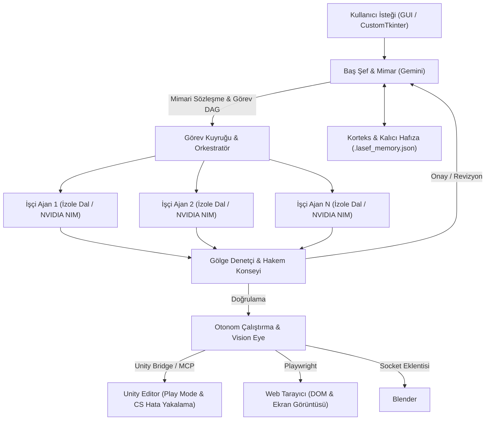

# LaSef — Çoklu Ajan AI Orkestrasyon Sistemi

**LaSef**, karmaşık yazılım, Unity oyun geliştirme, web uygulaması ve 3D (Blender) projelerini tek bir dil modeline yüklemek yerine; **sözleşmeye dayalı (contract-first)**, izole görev dağılımlı ve otonom doğrulama mekanizmalarına sahip çoklu yapay zeka ajanlarıyla (orkestra mantığı) üreten bir geliştirme platformudur.

---

## Temel Amaç

Tek bir LLM ile büyük projeler üretmeye çalışırken ortaya çıkan bağlam kaybı, dosya çakışmaları, yarım bırakılan kodlar ve derleme/çalışma zamanı hatalarını ortadan kaldırmak için tasarlanmıştır. Sistem projeyi mimari parçalara böler, her parçayı uzman işçi ajanlara dağıtır, çıktıları denetler ve hedef platformda (Unity, Web, Blender) bizzat çalıştırıp doğrular.

---

## Sistem Mimarisi



### Temel Çalışma Mekanizmaları

1. **Sözleşmeye Dayalı Planlama & DAG Motoru (`agents/chef_architect.py`, `orchestrator/dag_engine.py`)**
   - Baş Şef (Google Gemini), kod yazımına geçmeden önce tüm ajanların uymak zorunda olduğu bir **Mimari Sözleşme (Architecture Contract)** çıkarır (dosya yolları, sınıf/fonksiyon arayüzleri, bağımlılıklar).
   - Görevler bir **DAG (Directed Acyclic Graph)** olarak planlanır; bağımsız görevler paralel dalgalar halinde, bağımlı görevler ise üst adımlar tamamlandıktan sonra yürütülür.

2. **Worktree / Dal İzolasyonu (`orchestrator/workspace_manager.py`, `core/branch_memory_manager.py`)**
   - Paralel çalışan işçi ajanlar aynı anda birbirinin dosyasını ezmez.
   - Her işçi ajan yalnızca kendi hedef dosyasına odaklanır (Single Responsibility); diğer dosyaları değiştiremez, yalnızca bağımlı olduğu üst adımların onaylanmış çıktılarını okur.

3. **Uzman İşçi Havuzu & Akıllı Fallback (`agents/worker_agent.py`, `config.yaml`)**
   - İşçi ajanlar NVIDIA NIM üzerinden görev türüne göre (`kodlama`, `html`, `css`, `agir`, `denetim`, `vision`) farklı modellere yönlendirilir.
   - `config.yaml` içinde tanımlı `max_paralel`, `timeout_per_request` ve `fallback_models` ayarları sayesinde bir model yanıt vermezse veya zaman aşımına uğrarsa sistem otomatik olarak yedek modele geçer.

4. **Hakem Konseyi, Gölge Denetçi & Self-Healing (`agents/council_engine.py`, `agents/shadow_auditor.py`, `orchestrator/self_healing_test.py`)**
   - Kritik çıktılar çoklu model denetiminden ve oynanabilirlik kontrolünden geçer; onaylanmayan dosyalar revizyona gönderilir.
   - **Unity (`unity_autonomous_playtester.py`):** Sahneyi kurar, C# derleme hatalarını (CS errors) yakalar, Play Mode'a geçer ve GameView görüntüsünü Multimodal Vision ile inceleyip hata tespit ederse kendi kendini onarır.
   - **Web (`web_autonomous_playtester.py`):** Playwright ile tarayıcıda çalıştırır, DOM/konsol hatalarını ve ekran görüntülerini denetler; HTML-JS/CSS ID uyumsuzluklarını otomatik onarır.
   - **Blender (`blender_autonomous_runner.py`):** Socket köprüsü üzerinden 3D sahne/model işlemlerini yürütür.

5. **Korteks & Kalıcı Hafıza (`core/sourced_memory.py`)**
   - Proje boyunca alınan mimari kararlar ve öğrenilen kurallar `.lasef_memory.json` ve `.lasef_branches.json` dosyalarında saklanır. Uygulama kapatılıp açılsa dahi sistem proje bağlamını korur.

---

## Klasör Yapısı

```text
LaSef/
├── main.py                     # Uygulama giriş noktası (GUI başlatıcı)
├── LaSef_Baslat.bat            # Windows hızlı başlatma betiği
├── config.yaml                 # Model havuzu, paralel işçi ve zaman aşımı ayarları
├── requirements.txt            # Python bağımlılıkları
├── agents/                     # Baş Şef, İşçi Ajanlar, Hakem Konseyi, Gölge Denetçi
├── core/                       # Event Bus, Blackboard, Hafıza, MCP Router, Görev Kuyruğu
├── orchestrator/               # DAG motoru, Worktree/Workspace yöneticisi, Supervisor, Playtester'lar
├── infrastructure/             # Gemini, NVIDIA NIM, LLM ve medya istemcileri
├── tools/                      # Unity/Blender köprü istemcileri, MCP sunucuları, dosya araçları
├── ui/                         # CustomTkinter tabanlı masaüstü arayüzü
├── unity_bridge/               # Unity Editor içine yerleştirilen C# köprü sunucusu
└── blender_addon/              # Blender socket köprü eklentisi
```

---

## Kurulum ve API Yapılandırması

### 1. Gereksinimler
- Python 3.10+
- (İsteğe bağlı) Unity Editor — Unity otomasyonu için
- (İsteğe bağlı) Blender — 3D otomasyonu için

### 2. Bağımlılıkları Yükleyin
```bash
pip install -r requirements.txt
```
Web otomasyonunu kullanacaksanız Playwright tarayıcılarını da kurun:
```bash
playwright install
```

### 3. API Anahtarlarını Alın ve `.env` Dosyasını Oluşturun
Bu projenin çalışabilmesi için iki sağlayıcıdan API anahtarı almanız ve proje ana dizininde `.env` adlı bir dosya oluşturup içine yazmanız gerekir:

1. **Google Gemini API Key (`GEMINI_API_KEY`):** Baş Şef ve Mimar ajanları için kullanılır. Google AI Studio üzerinden alınır.
2. **NVIDIA NIM API Key (`NVIDIA_API_KEY`):** İşçi ajanlar, Gölge Denetçi ve Vision modelleri için kullanılır. NVIDIA Build (NIM) platformundan alınır.

Proje ana dizininde `.env` dosyasını oluşturun:

```env
# Zorunlu API Anahtarları
GEMINI_API_KEY=your_gemini_api_key_here
NVIDIA_API_KEY=your_nvidia_nim_api_key_here

# Opsiyonel Ayarlar
# NVIDIA_BASE_URL=https://integrate.api.nvidia.com/v1
# BLENDER_PATH=C:\Program Files\Blender Foundation\Blender 4.2\blender.exe
# LASEF_BLENDER_PORT=9876
```

> **Not:** `.env` dosyası `.gitignore` içinde tanımlıdır; gizlilik ve güvenlik için kesinlikle Git reposuna yüklenmemelidir.

### 4. Model ve Orkestra Ayarları (`config.yaml`)
Kullandığınız API hesabında aktif olan model isimlerini, paralel işçi limitini (`isci.max_paralel`) ve zaman aşımı sürelerini `config.yaml` dosyasından düzenleyebilirsiniz.

---

## Kullanım

### Uygulamayı Başlatma
Windows üzerinde `LaSef_Baslat.bat` dosyasına çift tıklayabilir veya terminalden çalıştırabilirsiniz:

```bash
python main.py
```

### Unity Köprüsünü Bağlama
1. `unity_bridge/Editor/LaSefBridge/LaSefBridgeServer.cs` dosyasını hedef Unity projenizin `Assets/Editor/LaSefBridge/` klasörüne kopyalayın.
2. Unity Editor'ı açın ve C# derlemesinin tamamlanmasını bekleyin; köprü sunucusu otomatik olarak dinlemeye başlar.
3. LaSef arayüzünden Unity projenizi hedef göstererek orkestrayı çalıştırın.

### Blender Köprüsünü Bağlama
1. `blender_addon/lasef_blender_bridge.py` dosyasını Blender üzerinden Eklenti (Add-on) olarak yükleyip etkinleştirin.
2. Gerekirse `.env` içine `BLENDER_PATH` değerini ekleyip LaSef üzerinden Blender görevlerini başlatın.
